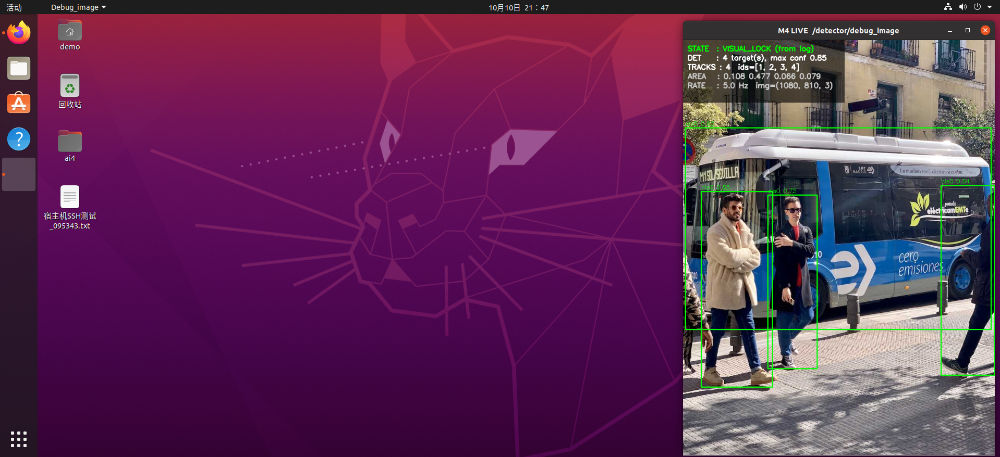
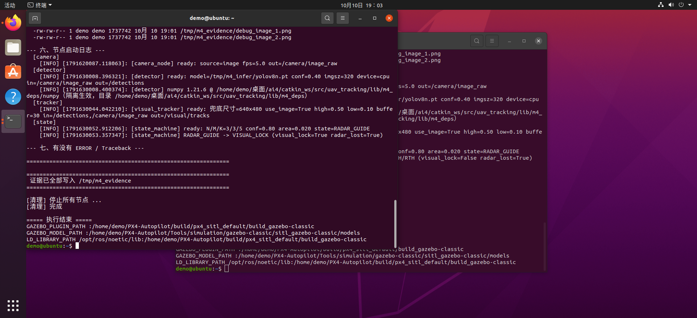

# M4 视觉感知链 · 使用文档

机载相机 → YOLOv8 检测 → 卡尔曼跟踪 → 状态机，输出目标检测框与稳定跟踪 ID。



## 1. 四个节点与话题

| 节点 | 订阅 | 发布 | 作用 |
|---|---|---|---|
| `/camera_node` | — | `/camera/image_raw` | 图源（图片 / 视频 / 真实相机） |
| `/detector` | `/camera/image_raw` | `/detections`、`/detector/debug_image` | YOLOv8 检测，每帧必发（无目标发空数组） |
| `/visual_tracker` | `/detections` | `/visual/tracks` | 卡尔曼滤波 + 两阶段 IoU 关联，输出稳定 ID |
| `/state_machine` | `/detections`、雷达状态 | `/state` | `RADAR_GUIDE → VISUAL_LOCK` 跃迁 |

## 2. 装依赖（只需一次）

```bash
cd <仓库根>
bash scripts/冲突库下载/install_m4_deps.sh          # 约 300 MB，装到 lib/m4
bash scripts/冲突库下载/install_m4_deps.sh --check  # 只检查现状
bash scripts/冲突库下载/install_m4_deps.sh --uninstall
```

系统 `numpy 1.17.4` / `cv2 4.2.0` **不会被改动**；冲突库清单见仓库根《冲突库汇总.md》的 M4 段。

## 3. 跑起来（一条命令）

```bash
bash test/M4_现场验证/实时演示/demo.sh
```

浏览器打开 `http://<虚拟机IP>:8090/`，页面实时显示画面、检测框和目标数。

```bash
bash test/M4_现场验证/实时演示/demo.sh moving   # 视频源，能看出跟踪框在动
bash test/M4_现场验证/实时演示/demo.sh stop     # 全部停止
```

## 4. 只起某个节点

```bash
roslaunch uav_tracking camera.launch
roslaunch uav_tracking detector.launch
roslaunch uav_tracking visual_tracker.launch
```

参数在 `catkin_ws/src/uav_tracking/config/*.yaml`，命令行可覆盖：

```bash
roslaunch uav_tracking detector.launch conf_thres:=0.8
roslaunch uav_tracking detector.launch model_path:=/abs/path/your.pt
```

## 5. 验证链路是否真的在工作

```bash
bash test/M4_现场验证/实时演示/verify.sh
```

输出 `PASS=16  FAIL=0` 即正常：节点注册、话题连接、检测频率、消息时间戳、
网页数据与 ROS 原始数据一致、`numpy` 隔离生效。



## 6. 换图像源

```bash
bash test/M4_现场验证/实时演示/set_camera_source.sh image /path/to/pic.jpg
bash test/M4_现场验证/实时演示/set_camera_source.sh video /path/to/clip.mp4
bash test/M4_现场验证/实时演示/set_camera_source.sh default
```

若图像话题不叫 `/camera/image_raw`，改参数即可：

```bash
rosparam set /detector/image_topic /your/camera/image_raw
rosparam set /visual_tracker/image_topic /your/camera/image_raw
```

## 7. 已知限制

- 权重为 `yolov8n`（COCO 80 类），**没有 drone 类**。对仿真里的无人机只能近似识别为 `kite`（置信度约 0.7），
  低于状态机 0.8 的锁定门限，因此接仿真时会出现“能看到、但不锁定”。
- 4 核 CPU：`imgsz=640` 约 0.5 Hz，`imgsz=320` 约 2 Hz，跟不上 30 Hz 相机时会丢帧（不影响链路正确性）。
- `yolov8n.pt` 为 gitignore 项，需自行放置，或由 `demo.sh` 自动调用 `get_assets.sh` 下载。
