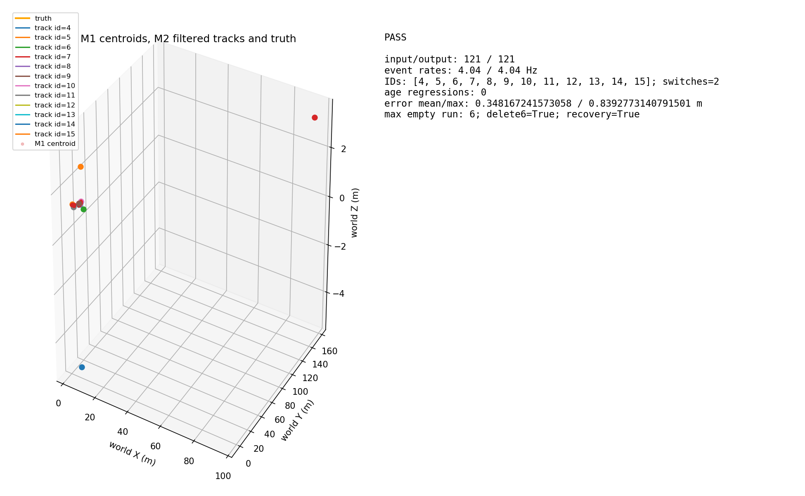
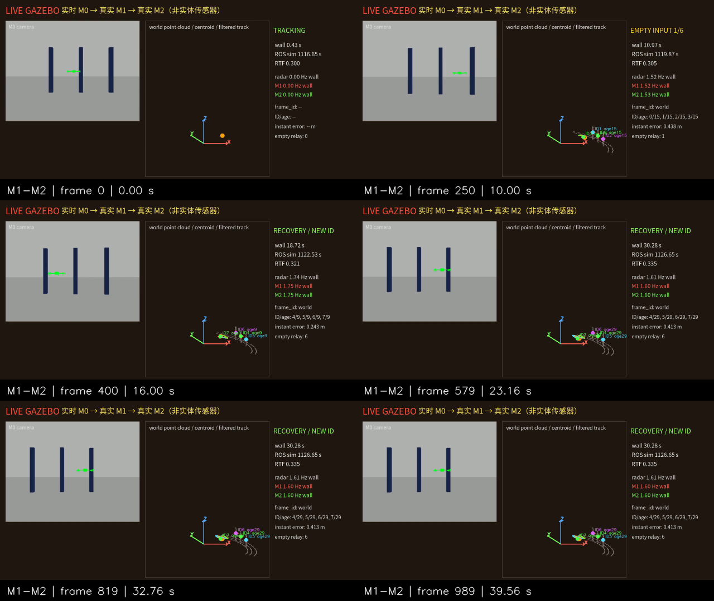

# M1 → M2 小联调

## 结论与数据流

**PASS**。发送方为 M1 Cluster，接收方为 M2 Tracker：

```text
/radar/centroid (uav_tracking/CentroidArray)
→ tracker
→ /radar/tracks (uav_tracking/TrackArray)
```

定量验收基于 develop `f540ae4e82ad614c8fb8560d7dad50675d66ad76`；
实时 Gazebo 演示基于 `3e3a5d57f8e59ceecf35cbf5fa8a78c41d8b347d`。
真实 M1 输入为 `frame_id=world`，同一数组内时间戳和 frame 一致；Tracker
按输入事件发布，不是固定频率节点。

## 环境、启动与复现

环境为 ROS Noetic、已构建的 `catkin_ws/devel`，以及 M0 创建的随机 ROS
master。M0 启动后，所有终端必须 source 同一 `connection.bash`，不得另起
`roscore`。

```bash
source /opt/ros/noetic/setup.bash
source catkin_ws/devel/setup.bash
source data/radar/<RUN_DIR>/connection.bash

roslaunch uav_tracking cluster.launch
rosrun topic_tools relay /radar/centroid /test/radar_centroid \
  __name:=m1_m2_real_relay
rosrun uav_tracking tracker_node.py \
  /radar/centroid:=/test/radar_centroid __name:=tracker_flow_m2 \
  _association_threshold:=2.0 _max_missed_frames:=5 \
  _process_noise:=1.0 _measurement_noise:=0.5 _initial_covariance:=1.0

/usr/bin/python3 test/flow/M1-M2/python/run_flow.py \
  --duration 30 --fault-start 15 --empty-count 6 \
  --output test/flow/M1-M2/log/<NEW_RUN>
```

`run_flow.py` 订阅真实 M1 数据和目标真值；透明中继只在故障窗口替换恰好
六帧为空数组。实时窗口使用 `python/live_panel.py`；实时采集入口为
`python/record_live_gazebo.py`。输入不合规时脚本记录 `DATA REJECTED`，不会
继续把该次运行判为通过。

## 实际结果与统计

- 最终定量运行：121 帧输入、121 帧输出，事件率 4.0402/4.0404 Hz。
- 六个连续空数组在第六个未匹配帧删除航迹；恢复后合理创建新 ID。
- `age_regressions=0`。
- 相对真值的平均/最大最近航迹误差为 0.3482/0.8393 m。
- 实时演示运行：67 帧输入、67 帧输出，六空帧删除与恢复均通过，平均/最大
  误差 0.3405/0.6386 m。





图中包含 world 三维坐标、M1 质心、M2 滤波航迹和尾迹、目标真值、ID、age、
误差以及输入/输出事件率。

## 证据文件

- 定量汇总：`log/20261115_run2/results_final/summary.json`
- 话题、类型、发布/订阅、样本和频率：
  `log/20261115_run2/final_topic_graph_samples_frequency.log`
- 定量审计：`log/20261115_run2/audit_final.log`
- 实时演示汇总与安全审计：`log/20261117_live_gazebo_run5/`
- 外部视频索引：`log/video-index-live-gazebo.json`

视频 `M1-M2_live_gazebo.mp4` 是 LIVE GAZEBO 数据，未加入 Git，避免二进制
文件增大仓库历史；索引保留其路径、SHA-256、来源和对应 run。视频由真实
M0 → 真实 M1 → 真实 M2 产生，但仍是仿真传感器链，不是飞控闭环。

## 已知限制与清理

误差使用每帧距离真值最近的航迹计算，不能由此推导复杂多目标关联性能。
本 flow 只验证 world 坐标消息链，不验证 world 与飞控 local ENU 的原点或
朝向对齐，也未录制 rosbag。

停止时只向本次启动的审计、中继、Tracker、Cluster 和 M0 终端发送 Ctrl+C，
不得按进程名批量清理。本流程不启动 control_mux、state_machine、MAVROS、
PX4 或 OFFBOARD，不发布 `/mavros/setpoint_raw/local`。
