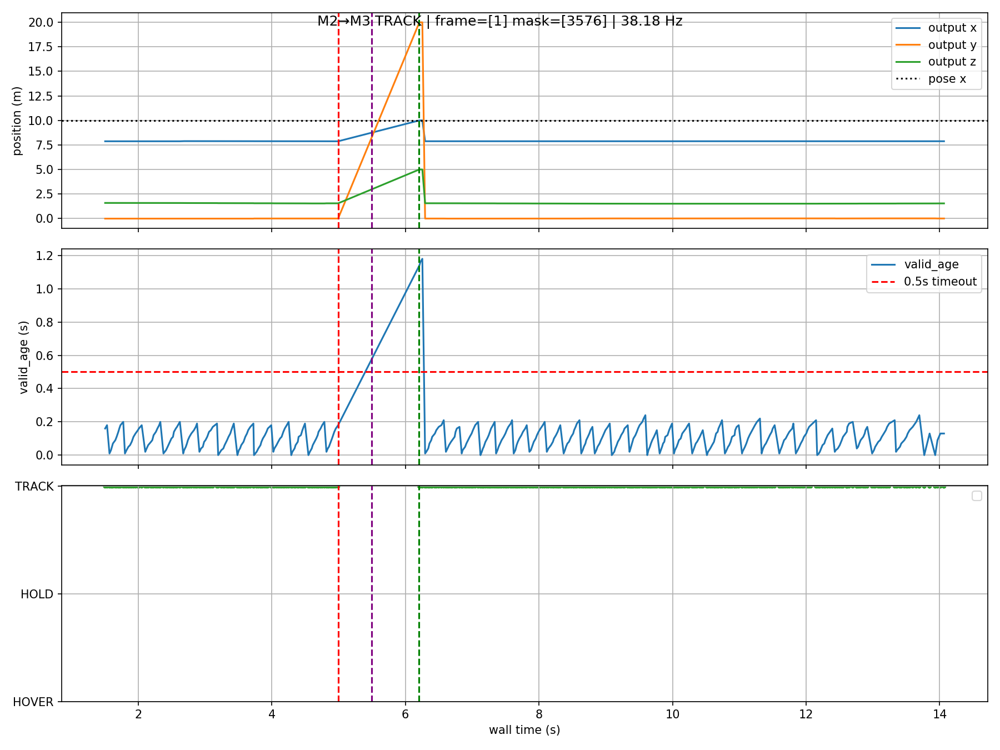
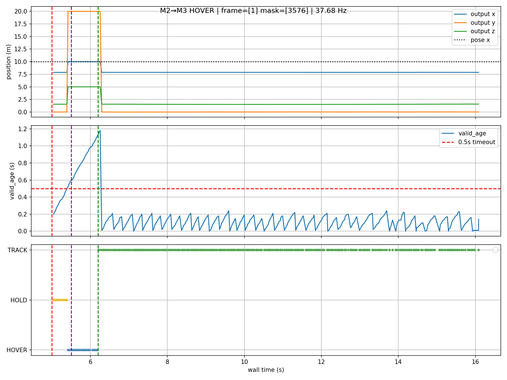
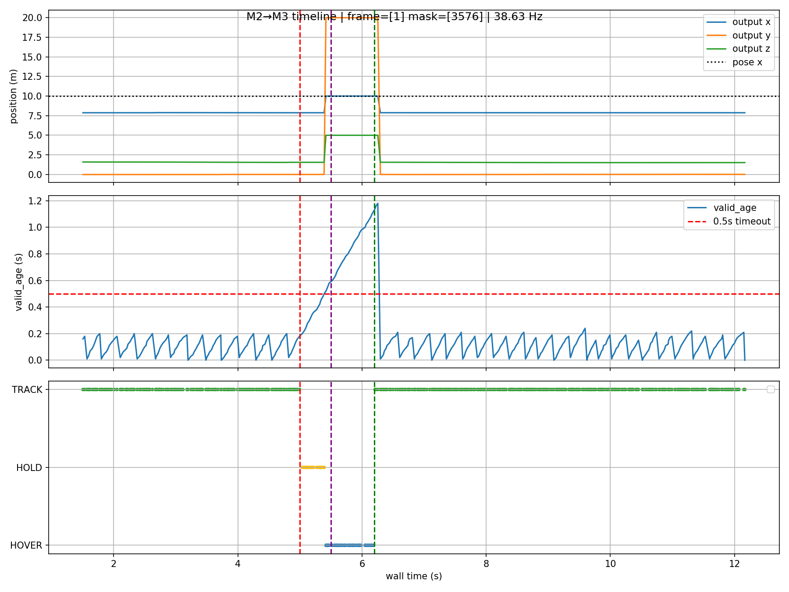
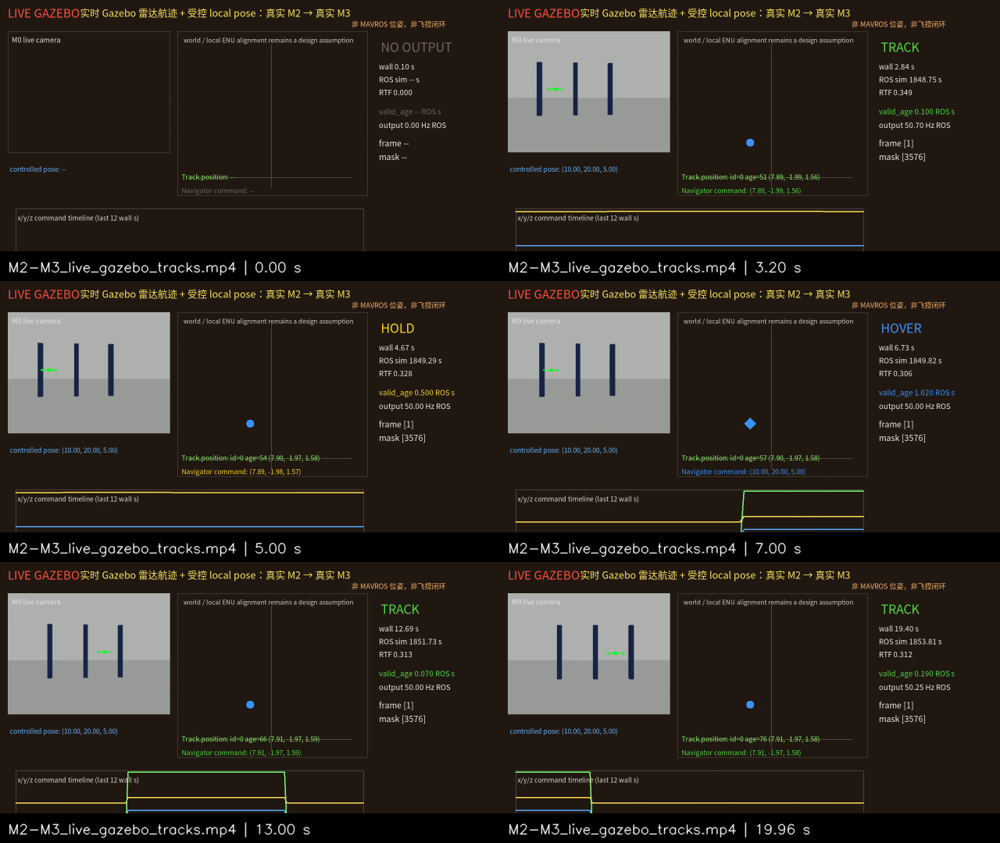

# M2 → M3 小联调

## 结论与数据流

**PASS**。发送方为真实 M2 Tracker，接收方为 M3 Navigator：

```text
/radar/tracks (uav_tracking/TrackArray)
+ /test/local_pose (geometry_msgs/PoseStamped，受控测试位姿)
→ navigator
→ /test/ctrl_radar (mavros_msgs/PositionTarget)
```

定量验收基于 develop `f540ae4e82ad614c8fb8560d7dad50675d66ad76`；
实时 Gazebo 演示基于 `3e3a5d57f8e59ceecf35cbf5fa8a78c41d8b347d`。
输出严格隔离，不连接 control_mux、MAVROS 或飞控。

## 环境、启动与复现

先按 M1→M2 文档在同一个随机 ROS master 启动 M0、Cluster 和 Tracker：

```bash
source /opt/ros/noetic/setup.bash
source catkin_ws/devel/setup.bash
source data/radar/<RUN_DIR>/connection.bash

/usr/bin/python3 test/flow/M2-M3/python/run_flow.py \
  --duration 12 --pose-delay 1.5 \
  --silence-start 5.0 --silence-end 6.2 \
  --pose 10 20 5 --output test/flow/M2-M3/log/<NEW_RUN>

rosrun uav_tracking navigator_node.py \
  /radar/tracks:=/test/radar_tracks \
  /mavros/local_position/pose:=/test/local_pose \
  /ctrl/radar:=/test/ctrl_radar \
  __name:=navigator_flow_m3 _rate_hz:=50.0 _hold_timeout:=0.5
```

脚本将真实 `/radar/tracks` 原样中继到 `/test/radar_tracks`，并以 20 Hz 提供
受控位姿 `(10,20,5)`。暂停中继覆盖 TRACK→HOLD→HOVER，再恢复真实航迹。
实时窗口使用 `python/live_panel.py`；实时采集入口为
`python/record_live_gazebo.py`。若隔离输出出现未知订阅者，脚本以
`DATA REJECTED` 停止。

## 实际结果与统计

- 定量运行：46 帧真实 Track、41 帧转发、413 帧输出。
- ROS 仿真时间输出频率 50.0 Hz；`coordinate_frame=1`、`type_mask=3576`。
- 首次位姿前无输出；TRACK、HOLD、0.5 ROS 秒后 HOVER、恢复均通过。
- 定量运行的 TRACK 映射误差和 HOVER 位姿误差均为 0。
- 实时验收运行收到 83 帧真实 Track、输出 795 帧，ROS 时间频率 50.0 Hz。









## 时序对齐复核

实时视频 run6 的原始回调时刻比较，把刚到达的新 Track 与上一条指令配对，
产生 22.35 m 的假误差。原始 `summary.json` 作为审计证据保留。对每个稳定
TRACK 输出只比较其之前已收到的 Track 后，共复核 201 个输出，最大和 P99
误差均为 0；frame/mask、TRACK/HOLD/HOVER 和恢复均通过。因此最终结论采用
时序对齐结果，而不是异步比较值。

## 证据文件

- 定量汇总：`log/20261115_run4/summary.json`
- 话题、类型、发布/订阅和输出样本：
  `log/20261115_run4/topic_graph_and_sample.log`
- 定量审计：`log/20261115_run4/audit.log`
- 实时定量 PASS：`log/20261117_live_gazebo_run2/summary.json`
- 原始异步比较与时间线：`log/20261117_live_gazebo_run6/summary.json`、
  `log/20261117_live_gazebo_run6/timeline.json`
- 时序对齐复核：`log/20261117_live_gazebo_run6/timing-aligned-review.json`
- 外部视频索引：`log/video-index-live-gazebo.json`

外部视频 `M2-M3_live_gazebo_tracks.mp4` 未加入 Git；索引保留文件 SHA-256、
来源和对应证据。画面来源是实时 Gazebo 雷达航迹加受控 local pose；该位姿
不是 MAVROS 位姿，视频不代表飞控闭环。

## 坐标边界、限制与清理

Navigator 不交换 x/y、不反转 z。测试记录 Track 的 world 数值、受控 local
ENU 位姿和 PositionTarget 数值，但不证明 Gazebo world 与飞控 local ENU 的
原点或朝向已经对齐，也不验证 MAVROS 下发。

停止时只向本轮审计和 Navigator 发送 Ctrl+C；如不再继续，再依次停止本轮
Tracker、Cluster 和 M0。不得批量清理其他会话。本流程未启动 control_mux、
state_machine、MAVROS、PX4 或 OFFBOARD，也未发布
`/mavros/setpoint_raw/local` 或录制 rosbag。
